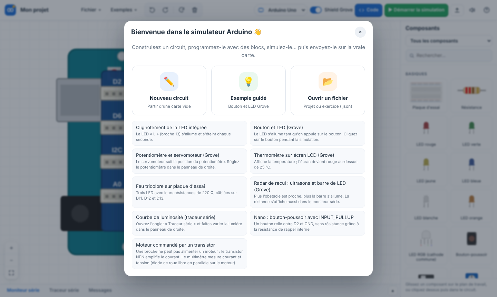
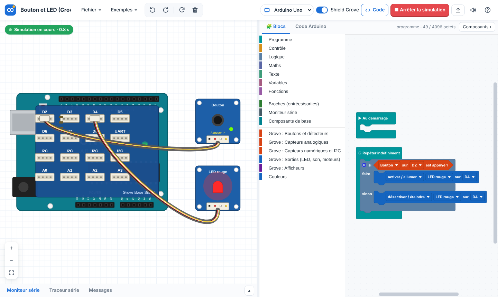
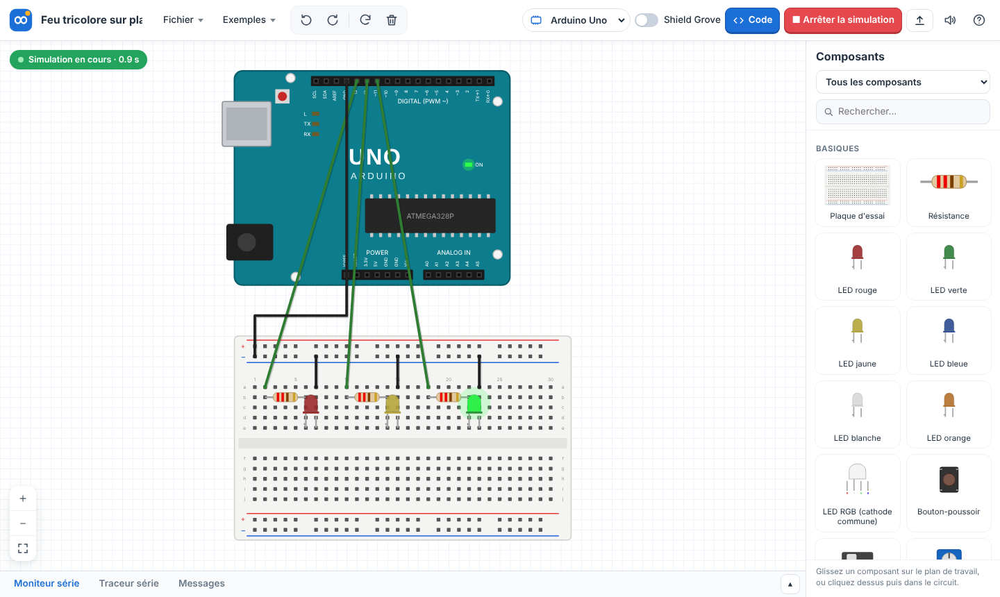
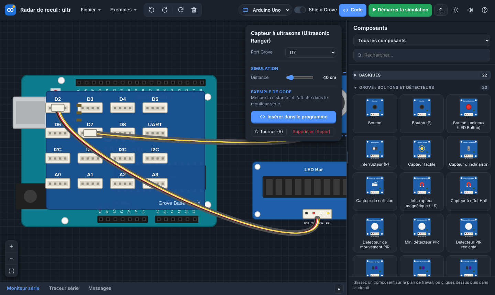

# Simulateur Arduino (hors ligne, sans installation)

Un simulateur de circuits Arduino inspiré de Tinkercad Circuits, pensé pour la classe (STI2D) :

- **un seul fichier** `dist/simulateur_arduino.html` à copier sur les postes, une clé USB ou l'ENT,
  qui s'ouvre par double-clic dans **Google Chrome** ou **Microsoft Edge**, **sans Internet ni installation** ;
- cartes **Arduino Uno, Nano et Mega 2560**, avec ou sans **shield Grove** ;
- **plus de 115 composants**, dont **95 modules Grove** (boutons, capteurs, LED, écrans LCD/OLED, afficheur 4 chiffres,
  servomoteur, ultrasons, DHT, baromètre, accéléromètre, rubans de LED…), et des composants de base pour plaque d'essai
  (résistances, LED, boutons, potentiomètre, diode, transistor NPN, moteur, afficheur 7 segments, **multimètre**…) ;
- programmation par **blocs** (Blockly, en français), avec le **code Arduino C++ équivalent** affiché et exportable en `.ino` ;
- simulation **électrique** (loi d'Ohm : une LED sans résistance grille, court-circuit, broche surchargée, entrée flottante)
  et **logique** des modules Grove ; **moniteur série** et **traceur série** ;
- **téléversement sur la vraie carte par USB**, directement depuis la page (Chrome/Edge), sans IDE ;
- **exercices** : l'enseignant écrit une consigne et peut verrouiller le circuit.





## Pour les élèves et l'enseignant

1. Copiez `dist/simulateur_arduino.html` où vous voulez (bureau, partage réseau, clé USB).
2. Ouvrez-le avec Chrome ou Edge (clic droit > Ouvrir avec si besoin).
3. Menu **Exemples** pour démarrer, bouton **?** pour l'aide.

Le travail est sauvegardé automatiquement dans le navigateur. **Fichier > Enregistrer** produit un fichier `.json`
(à rendre sur l'ENT, à rouvrir avec **Fichier > Ouvrir**).

### Construire un circuit

- Choisissez la carte en haut et cochez **Shield Grove** pour les modules Grove.
- Glissez un composant depuis la colonne **Composants** (à droite) vers le circuit, ou cliquez dessus puis dans le circuit.
  Le bouton **Code** affiche la programmation par blocs à la place des composants, comme dans Tinkercad.
- Les modules Grove se branchent tout seuls sur un port libre adapté (D, A ou I2C). Pour changer : panneau de droite,
  ou tirer le câble depuis le connecteur blanc du module jusqu'à un port.
- Fils : cliquer sur une broche puis sur une autre (clic dans le vide = coude, Échap = annuler). Les pattes posées sur la
  plaque d'essai ou sur les connecteurs de la carte sont reliées automatiquement.
- Le panneau **Composants** s'élargit en tirant sa poignée (double-clic : taille normale) ; la flèche devant chaque famille
  la replie ou la déplie.
- Dans la fiche d'un composant posé, **Insérer dans le programme** ajoute un exemple de code (blocs) déjà réglé sur le port
  ou la broche où il est branché.
- Le bouton lune/soleil bascule en **mode sombre**.
- Raccourcis : `R` tourner, `Suppr` supprimer, `Ctrl+Z` / `Ctrl+Y`, `Ctrl+S` enregistrer, `F5` simulation.

### Simuler

- **Démarrer la simulation** : cliquez sur les boutons du circuit, réglez les capteurs (lumière, distance, température…)
  dans le panneau de droite.
- L'onglet **Messages** signale les erreurs de câblage (LED grillée, court-circuit, module non alimenté, mauvais port…).

### Téléverser sur une vraie carte

1. Branchez la carte en USB, cliquez **Téléverser sur la carte**, puis **Choisir le port et téléverser**.
2. Chrome affiche la liste des ports : choisissez la carte (« Arduino Uno (COM3) », « USB-SERIAL CH340 »…).

Le simulateur installe sur la carte un petit **interpréteur** (toujours le même) avec le programme de l'élève :
le comportement est **identique** à celui de la simulation. Comptez 3 à 10 secondes. La carte garde le programme
une fois débranchée. Pour revenir à l'IDE Arduino, il suffit d'y téléverser un croquis : rien n'est modifié durablement.

- **Nano clone** : l'ancien et le nouveau bootloader sont détectés automatiquement (57 600 / 115 200 bauds).
- **Pilotes** : une page web ne peut pas installer de pilote. Les cartes officielles (Uno, Mega) n'en ont pas besoin sous
  Windows 10/11. Pour les clones à puce **CH340**, Windows 10/11 installe en général le pilote automatiquement via
  Windows Update à la première connexion (avec Internet). Si la carte n'apparaît jamais, le pilote CH340 doit être
  installé une fois par l'administrateur du poste.
- Sans Chrome/Edge : **Fichier > Exporter le fichier .hex** (programme complet), utilisable avec un outil de téléversement.

Le **moniteur série** peut aussi lire la vraie carte : source « Carte USB », choisir la vitesse, **Connecter**.

### Créer un exercice (enseignant)

**Fichier > Mode enseignant** : titre, consigne (mise en forme simple : `**gras**`, listes `-`, titres `#`),
option **Verrouiller le circuit**. Enregistrez puis distribuez le `.json` : à l'ouverture, l'élève voit la consigne
et ne peut modifier que le programme.





## Composants

La liste complète, avec ce qui fonctionne en simulation et sur la carte réelle, est dans [docs/MODULES.md](docs/MODULES.md).
Tous les modules fonctionnent dans le simulateur, et presque tous sur la carte réelle (Uno, Nano et Mega).
Cinq modules sont pour l'instant **en simulation seulement** : capteur de gestes PAJ7620, distance laser VL53L0X,
et les modules série (RFID 125 kHz, clavier 12 touches, lecteur MP3). Le simulateur prévient avant le téléversement
si le programme utilise un module non pris en charge par la carte.

Les pilotes de la carte réelle ont été vérifiés en émulation (micrologiciel exécuté dans un émulateur AVR avec des
modules I2C et des signaux simulés) ; ils restent à valider sur votre matériel.

## Limites connues

- On programme par blocs ; le code C++ affiché est **en lecture seule** (il peut être exporté et ouvert dans l'IDE Arduino,
  où il nécessite les bibliothèques Seeed indiquées en tête de fichier).
- La simulation électrique est simplifiée (régime continu, valeur moyenne du PWM) ; les modules Grove sont simulés au niveau
  de leur protocole (I2C, 1 fil…), pas au niveau des signaux.
- Valeurs numériques en flottant 32 bits (entiers exacts jusqu'à 16 777 216).

## Pour les développeurs

```
src/                  application (HTML, CSS, JavaScript sans dépendance de construction)
  js/vm_spec.js       jeu d'instructions commun au simulateur et au micrologiciel
  js/compiler.js      IR -> bytecode ; js/cppgen.js : IR -> C++ ; js/irbuilder.js : blocs -> IR
  js/vm.js            machine virtuelle du simulateur ; js/sim.js : moteur électrique et modules
  js/uploader.js      téléversement Web Serial (STK500 v1 / v2)
  vendor/             Blockly 11 (Apache 2.0)
firmware/             interpréteur C++ pour ATmega328P / ATmega2560 (+ pilotes Grove)
tools/build.py        assemble dist/simulateur_arduino.html
tests/                tests (VM vs micrologiciel émulé avec avr8js, électrique, protocoles, navigateur)
```

- Ouvrir `src/index.html` directement fonctionne aussi (développement).
- Reconstruire le fichier unique : `python3 tools/build.py`
- Recompiler le micrologiciel (Linux : `apt install gcc-avr avr-libc binutils-avr arduino-core-avr`) : `./firmware/build.sh`
- Tests : `npm install` puis `node tests/run_all.js` (tests navigateur avec Playwright : `NODE_PATH=$(npm root -g) node tests/run_all.js`).

Licences des bibliothèques incluses : voir `src/vendor/LICENCES.md`.
